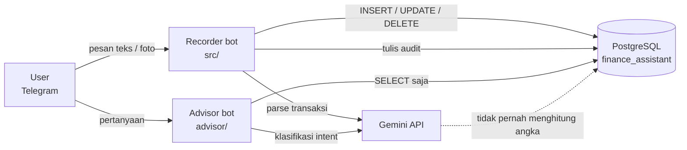
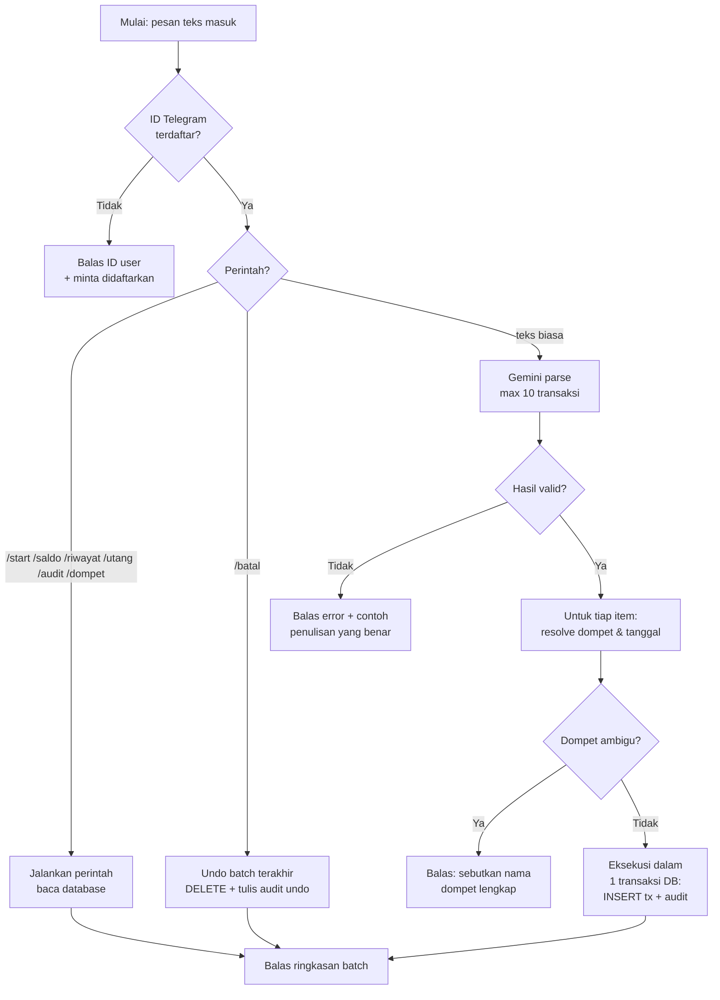
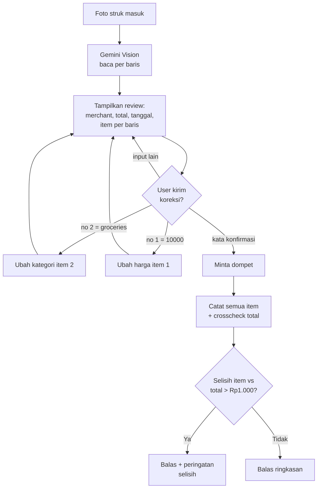
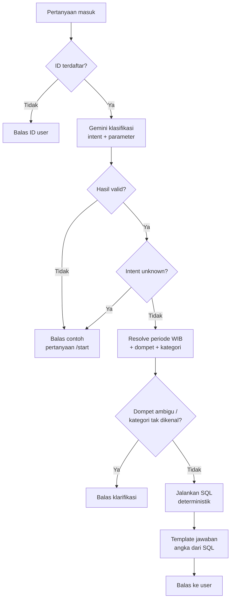
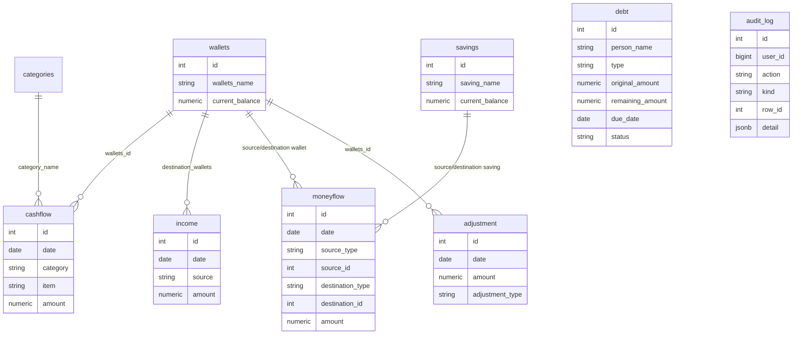
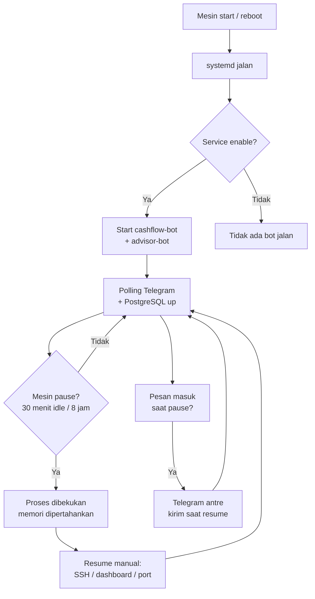

# Flow Diagram — Finance Assistant

Alur data dan flowchart sistem pencatat keuangan: recorder bot,
advisor bot, database, dan lifecycle VPS. Diagram memakai Mermaid
(ter-render langsung di Obsidian).

Lihat juga: [[install-instabox]] (instalasi di VPS),
[[postgresql]] (perintah dan skema database).

## Arsitektur sistem

Dua bot berbagi satu database. Recorder menulis, advisor hanya
membaca. Gemini dipakai keduanya, tapi dengan peran berbeda: recorder
memakainya untuk parsing transaksi, advisor hanya untuk memahami
pertanyaan — angka selalu dari SQL, tidak pernah dari AI.



Aturan arsitektur yang tidak boleh dilanggar:

- Satu token = satu instance polling. Dua instance dengan token sama
  → 409 Conflict.
- Advisor tidak punya jalur tulis: user database-nya SELECT-only
  dan koneksi disetel read-only.
- Semua tanggal transaksi = WIB, dihitung di Python
  (`today_wib()`), bukan di database.

## Flow recorder: pesan teks



Catatan penting:

- Ambiguitas dompet **tidak** disimpan sebagai state. Bot hanya
  membalas meminta nama lengkap, user mengirim ulang pesan dengan
  nama dompet lengkap. Cocokkan: persis → partial unik → ambigu
  (tanya) → tidak dikenal (error).
- `/batal` meng-undo **seluruh batch terakhir**, bukan satu item.
- State `_last_action` (untuk undo) hidup di memori: survive pause
  mesin, hilang kalau service restart.
- Arah hutang ditentukan subjek kalimat: `[NAMA] bayar` = uang
  masuk (piutang dibayar), `bayar hutang ke [NAMA]` = uang keluar.
  Salah arah = error pintar yang menampilkan kondisi hutang aktual
  + contoh penulisan ulang.

## Flow recorder: OCR struk



Aturan OCR yang lahir dari bug nyata:

- Prompt membaca **total tercetak per baris**, tidak pernah
  menghitung `qty × harga`. (Kasus nyata: `2 ... 10000` pernah
  dihitung jadi 20000.)
- Pending OCR disimpan di disk — survive restart service.
- Input yang tidak dikenali saat review **tidak** menghapus
  pending; bot menampilkan ulang review.
- Crosscheck: jumlah item vs total struk, peringatan kalau selisih
  > Rp1.000.

## Flow advisor: tanya-jawab



Intent yang didukung V1:

| Intent | Query | Filter opsional |
|---|---|---|
| `expense_total` | SUM cashflow | dompet, kategori |
| `expense_by_category` | SUM per kategori, GROUP BY | dompet |
| `income_vs_expense` | SUM income vs SUM cashflow | — |
| `top_expenses` | ORDER BY amount DESC LIMIT | dompet, kategori |
| `balances` | wallets + savings + total | — |
| `debts` | debt WHERE status <> 'paid' | — |
| `monthly_summary` | gabungan 4 query di atas | — |

Periode yang dipahami: hari ini, minggu ini, bulan ini, bulan lalu,
bulan bernama (`oktober` = kemunculan terakhir bulan itu di masa
lalu), tahun ini, selama ini. Perintah cepat: `/ringkasan`,
`/saldo`, `/utang` (melewati klasifikasi).

## Relasi antar tabel



Catatan relasi:

- `cashflow.wallets_id` NULL = pengeluaran dari tabungan (skema
  tidak punya kolom sumber tabungan di `cashflow`).
- `moneyflow` memakai pasangan `source_type`/`source_id` dan
  `destination_type`/`destination_id` karena sumber/tujuan bisa
  dompet **atau** tabungan.
- `debt` tidak terhubung ke dompet: hutang baru dan pembayaran
  bisa dicatat tanpa dompet; saldo dompet hanya bergerak kalau
  dompet disebut.
- `audit_log` tidak punya foreign key — sengaja, supaya jejak
  tetap ada meskipun baris transaksi dihapus undo.

## Lifecycle VPS dan systemd



Perintah yang menggerakkan diagram ini:

```bash
sudo systemctl enable cashflow-bot.service advisor-bot.service
sudo systemctl start cashflow-bot.service advisor-bot.service
sudo systemctl status cashflow-bot.service advisor-bot.service
sudo systemctl restart cashflow-bot.service
sudo journalctl -u cashflow-bot.service -n 30
```

Update kode: `git pull` lalu restart service yang berubah.
Pause/resume tidak butuh start ulang service — proses dilanjutkan
dari titik beku.
